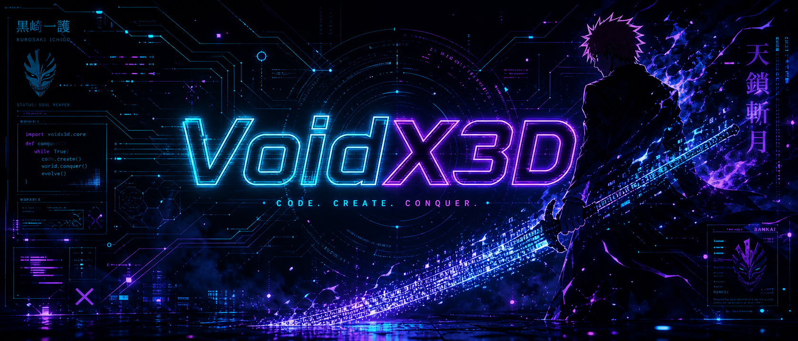

<div align="center">



<br />


# VoidX3D

### Sincere Bhattarai · Full-Stack Developer · AI Automation Enthusiast

[](https://voidx3d.vercel.app)
[](https://github.com/VoidX3D)
[](https://github.com/VoidX3D?tab=followers)
[](https://github.com/VoidX3D)

**I turn ideas into practical web applications, developer tools, Android projects, and experiments with automation and AI.**

</div>

---

## About me

I'm **Sincere Bhattarai**, known online as **VoidX3D** — a self-taught developer from Nepal who enjoys taking ideas from rough concepts to working software.

My main interests are full-stack web development, backend APIs, Linux, open-source collaboration, Android development, and AI-powered automation. I care about useful features, focused interfaces, maintainable systems, and being honest about what is shipped, experimental, or still planned.

```ts
const voidx3d = {
  focus: ["Full-stack web development", "AI automation", "Linux"],
  currentlyBuilding: "Useful software and better developer workflows",
  mindset: "Build → experiment → learn → improve",
};
```

## What I build

| Area | What I enjoy building |
| --- | --- |
| 🌐 **Web applications** | Full-stack products, dashboards, PWAs, and interactive experiences |
| ⚙️ **Backend systems** | APIs, databases, real-time features, and practical application architecture |
| 📱 **Android apps** | Kotlin-based applications, music players, and focused mobile experiences |
| 🤖 **AI automation** | Tool-using agents, developer workflows, and experiments that reduce repetitive work |
| 🐧 **Linux & open source** | Linux-based development, self-hosting ideas, and community software |

## Featured projects

### 🎮 [FamilyGame](https://github.com/VoidX3D/FamilyGame)

A browser-based multiplayer experience designed for friends and family to play together in private rooms.

- Multiple game modes and configurable game content
- Private rooms, room management, and player coordination
- Host controls and server-managed game state
- Mobile and desktop browser support

**Stack:** JavaScript · Node.js · Express · Socket.IO · HTML · CSS

[](https://funfamilygame.vercel.app)
[](https://github.com/VoidX3D/FamilyGame)

> A working deployed version exists, with further development and improvements planned.

### 🎵 [Pixel Player](https://github.com/PixelPlayerHQ/PixelPlayer)

An open-source Android music player built with Kotlin and Jetpack Compose. I have contributed to library initialization performance and improvements across AI-related settings and interface behavior.

[](https://github.com/PixelPlayerHQ/PixelPlayer/pull/2497)

### 🍿 [Anime Tracker](https://github.com/VoidX3D/Anime-Tracker)

A web application for tracking anime, exploring titles, and organizing a personal anime list.

**Stack:** Next.js · Supabase · AniList API · MyAnimeList API · PWA

[](https://anime-tracker-neon.vercel.app)
[](https://github.com/VoidX3D/Anime-Tracker)

### ✨ [I'm Sorry](https://github.com/VoidX3D/ImSorry)

A cinematic interactive web experience built with React, Vite, Canvas, and animated particle effects.

[](https://iamreallysorry.vercel.app/full-letter)

## More projects

- 🌱 [RU Club Website](https://github.com/VoidX3D/RU_Club_Website) — website for a student environmental initiative.
- 🛠️ [RU Admin Site](https://github.com/VoidX3D/RU_Admin_Site) — administrative dashboard using React, TypeScript, and Supabase.
- 🧪 [Portfolio](https://voidx3d.vercel.app) — personal project hub and developer portfolio.
- 📚 **Digital Library** — a previously developed school-community library project; current maintenance status is to be confirmed.

## Technology

<div align="center">

### Languages

<a href="https://developer.mozilla.org/en-US/docs/Web/JavaScript"></a>
<a href="https://www.typescriptlang.org/"></a>
<a href="https://www.python.org/"></a>
<a href="https://kotlinlang.org/"></a>
<a href="https://developer.mozilla.org/en-US/docs/Web/HTML"></a>
<a href="https://developer.mozilla.org/en-US/docs/Web/CSS"></a>
<a href="https://www.gnu.org/software/bash/"></a>

### Frontend and backend

<a href="https://react.dev/"></a>
<a href="https://nextjs.org/"></a>
<a href="https://nodejs.org/"></a>
<a href="https://expressjs.com/"></a>
<a href="https://socket.io/"></a>
<a href="https://supabase.com/"></a>
<a href="https://www.postgresql.org/"></a>

### Tools and infrastructure

<a href="https://www.linux.org/"></a>
<a href="https://git-scm.com/"></a>
<a href="https://github.com/"></a>
<a href="https://code.visualstudio.com/"></a>

</div>

> This list reflects my main working areas and interests, not equal proficiency in every technology.

## Currently exploring

- AI agents and practical developer automation
- Reliable backend architecture, APIs, and real-time systems
- Linux development workflows, self-hosting, and developer tooling
- Open-source contribution and long-term project maintenance
- Distributed and multi-device computing
- Maintainable software with practical, intentional interfaces

## Roadmap

These are longer-term concepts, not shipped products:

- **VoidDrive** — a planned personal file platform focused on organization, sharing, permissions, and reliable data handling.
- **VoidCloud** — a planned part of the wider VoidX3D ecosystem for connected services and infrastructure.
- **VoidStreamz** — a future project concept whose final scope is still being established.
- **VoidApps** — an umbrella concept for applications and tools developed under the VoidX3D identity.
- **Zen** — an experimental AI-system concept exploring hosted models, tool use, automation, and multi-device coordination.

Security, privacy, and reliability are design goals for future projects and should not be interpreted as implemented guarantees until publicly demonstrated and verified.

## GitHub activity

<div align="center">

<a href="https://github.com/VoidX3D"></a>
<a href="https://github.com/VoidX3D"></a>

</div>

<div align="center">


</div>

## Contribution snake

<div align="center">

<picture>
  <source media="(prefers-color-scheme: dark)" srcset="https://raw.githubusercontent.com/VoidX3D/VoidX3D/output/github-contribution-grid-snake-dark.svg" />
  <source media="(prefers-color-scheme: light)" srcset="https://raw.githubusercontent.com/VoidX3D/VoidX3D/output/github-contribution-grid-snake.svg" />
  
</picture>

</div>

## Let's connect

I'm interested in open-source collaboration, constructive feedback, technical discussion, and building useful software with other developers.

- **Portfolio:** [voidx3d.vercel.app](https://voidx3d.vercel.app)
- **GitHub:** [@VoidX3D](https://github.com/VoidX3D)

<div align="center">

*Build. Experiment. Learn. Improve.*

**VoidX3D · Sincere Bhattarai · Nepal**

</div>
